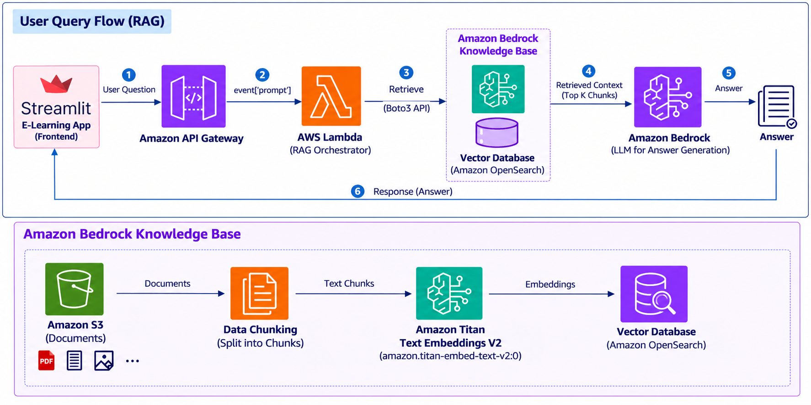

# e-learning-platform

An AI learning assistant that helps learners find answers in their course materials using everyday language.

## The problem

Learning materials are often spread across long PDFs and other documents. Finding one explanation can mean opening several files and searching through many pages. A general AI chatbot may also give a plausible answer without knowing what the course actually teaches.

We want learners to ask a question and get a clear explanation based on the learning materials provided to the platform.

## Our approach: RAG

**RAG stands for Retrieval-Augmented Generation.** In simple language, it means **find relevant information first, then use AI to explain it**.

Think of it as an open-book tutor. Before answering, the tutor looks up the relevant passages in the course books and uses those passages to prepare a response.

The **knowledge base** is the searchable collection of course content. RAG is the process that connects that content to the AI answering the learner's question. This approach supplies information to the model when a question is asked; it does not retrain the model on the documents.

## Architecture



### 1. Prepare the learning materials

The bottom half of the diagram shows how documents become searchable:

The documents can come from different sources, such as Google Drive, SharePoint, or other document storage systems. This architecture uses **Amazon S3** as its data source. Other sources can be connected through a suitable connector or ingestion process.

1. **Store documents in Amazon S3.** This is the storage location for the learning materials.
2. **Split the content into chunks.** Smaller passages make it easier to find the specific information needed for a question.
3. **Create embeddings with Amazon Titan Text Embeddings V2.** An embedding is a list of numbers that represents the meaning of a passage. It helps the system find related ideas even when the learner uses different words.
4. **Store the embeddings in Amazon OpenSearch.** The vector database supports searching for passages with meanings similar to the learner's question. Amazon Bedrock Knowledge Bases connects the documents and the search process.

### 2. Answer a learner's question

The top half of the diagram shows what happens when someone asks for help:

1. The learner types a question in the **Streamlit app**.
2. **Amazon API Gateway** receives the request and passes it to **AWS Lambda**.
3. Lambda coordinates the work and retrieves relevant passages from the **Amazon Bedrock knowledge base** using the AWS SDK, Boto3.
4. The retrieved passages—the **top K chunks**, meaning a selected number of the closest matches—provide context for a language model in **Amazon Bedrock**.
5. The model uses the question and those passages to generate an explanation.
6. The answer returns to the learner in the app.

## A simple example

Imagine an organization has hundreds of internal documents, such as company policies, training guides, and project instructions. Finding one answer can take time because employees have to open several documents and search through them one by one.

With this approach, an employee can simply type a question in the app.

**Example question:** "How do I request access to a project?"

The system searches the internal documents, finds the relevant information, and provides a simple answer with links to the source documents.

**Example answer:** "Submit an access request through the IT portal and get approval from your project manager."

Along with the answer, the app would show links to the relevant sections of the *Project Access Guide* and *IT Access Policy*. These document names are examples.

The employee can use those links to check the information or read more. They do not have to search every document themselves, which saves time and makes information easier to find.

## Why this matters

- **Less time searching:** Learners can ask questions instead of browsing entire documents.
- **More relevant explanations:** The AI receives material from the course before answering.
- **Search by meaning:** A question can match a useful passage even if it uses different wording.
- **Updatable content:** When course documents change, the knowledge base can be synchronized so future questions use the updated material.

RAG helps ground answers in source material, but it does not guarantee correctness. A useful implementation should show the supporting sources and acknowledge when the documents do not contain enough information.

## Python dependencies

Use Python 3.12 and install the Python packages listed in [requirements.txt](requirements.txt) in a virtual environment:

```powershell
py -3.12 -m venv .venv
.\.venv\Scripts\Activate.ps1
python -m pip install -r requirements.txt
```

- **Streamlit:** Builds the interface where users ask questions and read answers.
- **Requests:** Sends questions from the interface to the API Gateway endpoint.
- **Boto3:** Connects the Python backend to S3 and Amazon Bedrock.

Pip installs the supporting packages automatically. API Gateway, Lambda, S3, Bedrock, and OpenSearch are AWS services configured separately. Bedrock Knowledge Bases handles document chunking, embeddings, and retrieval, so this flow does not require a separate local vector database or PDF processing library.

The root requirements file covers the frontend and local AWS development. For Lambda deployment, package only the backend dependencies; Streamlit belongs in the frontend environment.

## Serverless Framework

We use **Serverless Framework** to define and deploy the AWS Lambda backend and API Gateway configuration. It is a Node.js development tool, so it is listed in [package.json](package.json), separately from the Python packages in `requirements.txt`.

Use Node.js 24, as specified in [.nvmrc](.nvmrc), then install the tooling:

```powershell
npm ci
```

The [package-lock.json](package-lock.json) records the Node.js dependency versions. The backend's functions, API routes, and AWS settings will be defined in `serverless.yml` when we add the backend. Serverless Framework v4 requires a Serverless account or license key for deployment.

## GitHub Actions pipeline

The [GitHub Actions workflow](.github/workflows/ci.yml) runs on pull requests targeting `main`, pushes to `main`, and manual runs. It installs the Python packages, checks for dependency conflicts, verifies the main imports, and installs and checks the Serverless Framework dependency.

This gives us an early check that the project's dependencies can be installed together. The workflow checks dependencies only; application tests and Serverless configuration validation will be added alongside the backend code.

For deployment, the next step is a separate workflow that uses GitHub OIDC to assume an AWS deployment role, packages the backend, and runs `serverless deploy`. That workflow will need the AWS region, deployment role, knowledge base configuration, and Serverless authentication configured first.

## What about keys and credentials?

The knowledge base and embeddings help find information. **Credentials serve a different purpose: they control access to AWS services.** The diagram does not specify an API key or sign-in mechanism.

Lambda should use an IAM execution role with the permissions it needs. AWS secret keys should never be embedded in the frontend or committed to this repository.
