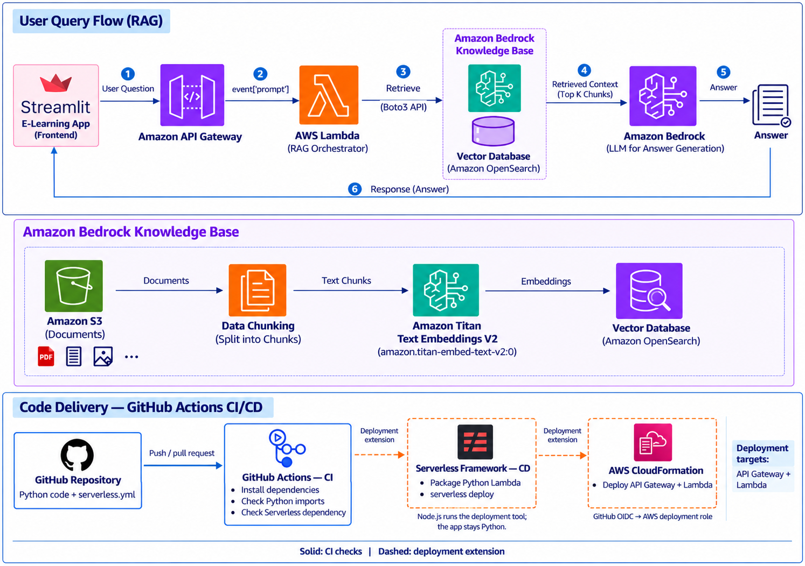

# e-learning-platform

An AI learning assistant that helps learners find answers in their course materials using everyday language.

## The problem

Learning materials are often spread across long PDFs and other documents. Finding one explanation can mean opening several files and searching through many pages. A general AI chatbot may also give a plausible answer without knowing what the course actually teaches.

We want learners to ask a question and get a clear explanation based on the learning materials provided to the platform.

## Our approach: RAG

**RAG stands for Retrieval-Augmented Generation.** In simple language, it means **find relevant information first, then use AI to explain it**.

Think of it as an open-book tutor. Before answering, the tutor looks up the relevant passages in the course books and uses those passages to prepare a response.

The **knowledge base** is the searchable collection of course content. RAG is the process that connects that content to the AI answering the learner's question. This approach supplies information to the model when a question is asked; it does not retrain the model on the documents.

## Architecture



**API Gateway and Lambda are both serverless AWS services:** API Gateway receives requests, and Lambda runs the Python backend without us managing servers. The diagram shows **Serverless Framework** as deployment tooling outside the path of a user's question. The current knowledge-base pipeline submits native YAML directly to **CloudFormation**; the optional Serverless entry point imports the same infrastructure definitions.

### 1. Prepare the learning materials

The bottom half of the diagram shows how documents become searchable:

The documents can come from different sources, such as Google Drive, SharePoint, or other document storage systems. This architecture uses **Amazon S3** as its data source. Other sources can be connected through a suitable connector or ingestion process.

1. **Store documents in Amazon S3.** This is the storage location for the learning materials.
2. **Split the content into chunks.** Smaller passages make it easier to find the specific information needed for a question.
3. **Create embeddings with Amazon Nova Multimodal Embeddings.** An embedding is a list of numbers that represents the meaning of a passage. It helps the system find related ideas even when the learner uses different words.
4. **Store and index the embeddings in the managed knowledge base.** Amazon Bedrock manages vector storage, indexing, and retrieval. The infrastructure uses this managed storage rather than a separate OpenSearch collection shown in the diagram.

### 2. Answer a learner's question

The top half of the diagram shows what happens when someone asks for help:

1. The learner types a question in the **Streamlit app**.
2. **Amazon API Gateway** receives the request and passes it to **AWS Lambda**.
3. Lambda coordinates the work and retrieves relevant passages from the **Amazon Bedrock knowledge base** using the AWS SDK, Boto3.
4. The retrieved passages—the **top K chunks**, meaning a selected number of the closest matches—provide context for a language model in **Amazon Bedrock**.
5. The model uses the question and those passages to generate an explanation.
6. The answer returns to the learner in the app.

## A simple example

Imagine an organization has hundreds of internal documents, such as company policies, training guides, and project instructions. Finding one answer can take time because employees have to open several documents and search through them one by one.

With this approach, an employee can simply type a question in the app.

**Example question:** "How do I request access to a project?"

The system searches the internal documents, finds the relevant information, and provides a simple answer with links to the source documents.

**Example answer:** "Submit an access request through the IT portal and get approval from your project manager."

Along with the answer, the app would show links to the relevant sections of the *Project Access Guide* and *IT Access Policy*. These document names are examples.

The employee can use those links to check the information or read more. They do not have to search every document themselves, which saves time and makes information easier to find.

## Why this matters

- **Less time searching:** Learners can ask questions instead of browsing entire documents.
- **More relevant explanations:** The AI receives material from the course before answering.
- **Search by meaning:** A question can match a useful passage even if it uses different wording.
- **Updatable content:** When course documents change, the knowledge base can be synchronized so future questions use the updated material.

RAG helps ground answers in source material, but it does not guarantee correctness. A useful implementation should show the supporting sources and acknowledge when the documents do not contain enough information.

## Sample learning program demo

The demo uses five short documents from a fictional learning program. They cover onboarding, practice hours, skills, mentor reviews, and learner progress. Users can ask questions and receive answers with supporting sources. All program rules and records are fictional.

## Ask questions in the app

The Streamlit interface lets users enter a question, read the answer, and open the supporting sources. It shows a loading indicator while waiting and clear messages when a request fails. Follow the [frontend setup instructions](streamlit-ui/README.md) to run it locally, configure the backend connection, or host it on Streamlit Community Cloud.

## Project organization

| Area | Responsibility |
| --- | --- |
| `streamlit-ui/` | Frontend, API client, UI tests, and frontend dependencies. |
| `backend/` | Backend dependencies and future Python API and retrieval code. |
| `infrastructure/` | AWS resources, global infrastructure settings, and deployment tooling. |
| `docs/` | Shared architecture and demo documentation. |
| `data/demo/` | Fictional source documents used for demonstrations. |
| `.github/workflows/` | CI/CD automation. |
| `.streamlit/` | Shared Streamlit hosting configuration and secret templates. |

Keep each component's code, tests, dependencies, and setup instructions together. The root Python requirements combine component dependencies for local development.

## Python dependencies

Use Python 3.12 and install the Python packages listed in [requirements.txt](requirements.txt) in a virtual environment:

```powershell
py -3.12 -m venv .venv
.\.venv\Scripts\Activate.ps1
python -m pip install -r requirements.txt
```

- **Streamlit:** Builds the interface where users ask questions and read answers.
- **Requests:** Sends questions from the interface to the API Gateway endpoint.
- **Boto3:** Connects the Python backend to S3 and Amazon Bedrock.

Pip installs the supporting packages automatically. API Gateway, Lambda, S3, Bedrock, and OpenSearch are AWS services configured separately. Bedrock Knowledge Bases handles document chunking, embeddings, and retrieval, so this flow does not require a separate local vector database or PDF processing library.

The root requirements file covers the frontend and local AWS development. For Lambda deployment, package only the backend dependencies; Streamlit belongs in the frontend environment.

## Serverless Framework

The repository includes **Serverless Framework** tooling for backend and API Gateway work. The knowledge-base pipeline deploys native CloudFormation YAML directly and does not require a Serverless account or license. Node.js tooling is kept with the infrastructure, separately from the Python application dependencies.

Use Node.js 24, then install the deployment tooling from the infrastructure directory:

```powershell
Push-Location infrastructure
npm ci
Pop-Location
```

The infrastructure component owns the resource YAML, each template's top-level parameters, optional Serverless configuration, and dependency lockfile. See the [infrastructure guide](infrastructure/README.md) for deployment details. Using the optional Serverless Framework v4 CLI separately requires its own authentication.

## Knowledge base document storage

The data source bucket is **`e-learning-platform-knowledge-base`**. Its infrastructure configuration includes:

- **Encryption at rest:** Default server-side encryption using S3-managed keys (SSE-S3, AES-256).
- **Private access:** All S3 public access settings are blocked, and ACLs are disabled.
- **Encrypted connections:** A bucket policy denies HTTP requests from non-service principals; use HTTPS when accessing documents.
- **Versioning:** Previous document versions are kept when files are overwritten or deleted normally.
- **Retention:** CloudFormation retains the bucket and documents if the stack is deleted or the bucket resource is replaced.

Deployments run through GitHub Actions after changes are pushed to `main` and all checks pass. Local deployment commands are blocked. The [infrastructure guide](infrastructure/README.md) describes the OIDC deployment role. No Serverless secret is needed by the CloudFormation pipeline.

Each infrastructure template declares its own settings in a `Parameters` section at the top and references them below with `Ref` or `Fn::Sub`. There is no separate parameter file. The build combines the templates and checks that any shared parameter definitions agree. The optional Serverless entry point defines its own settings at the top. Existing deployed parameter overrides are preserved during updates.

Choose the region where the knowledge base will run. The bucket name is globally unique, so use it from one stack only. If another account already owns the name, update the global bucket name before deploying. A bucket created outside this stack must be imported rather than recreated.

The stack outputs the bucket name and ARN, along with the managed knowledge base and data source IDs.

## Managed knowledge base

The infrastructure defines a managed Amazon Bedrock knowledge base using Amazon Nova Multimodal Embeddings with on-demand inference. Bedrock manages the vector storage and indexing. The S3 connector is limited to the project's demo-document prefix, uses default chunking, and has no automatic sync schedule.

The dedicated service role can read only that source prefix and invoke the selected embedding model. The pipeline restricts its trust to the exact knowledge base after creation. Application log delivery targets `/aws/vendedlogs/bedrock/e-learning-platform/dev/knowledge-base` with 30-day retention. See the [infrastructure guide](infrastructure/README.md) for configuration details.

## GitHub Actions pipeline

The [GitHub Actions workflow](.github/workflows/ci.yml) runs on pull requests targeting `main`, pushes to `main`, and manual runs. It installs the Python packages, checks for dependency conflicts, verifies the main imports, runs frontend and API-client tests, and installs and checks the Serverless Framework dependency.

This checks dependency installation, frontend behavior with mocked responses, infrastructure YAML, and deployment safety. A deployment job runs only for trusted `main`-branch pushes or manual workflow runs after these checks pass.

The deployment job uses GitHub OIDC, merges and validates the native YAML template, checks and executes a CloudFormation change set, and verifies the resulting knowledge base. It rejects resource removals and possible replacements. Its readable YAML template and deployment summary are saved as workflow artifacts. The one-time deployment role is provisioned separately; the pipeline needs its ARN but no Serverless credential. Streamlit hosting is managed separately.

## What about keys and credentials?

The knowledge base and embeddings help find information. **Credentials serve a different purpose: they control access to AWS services.** The diagram does not specify an API key or sign-in mechanism.

Lambda should use an IAM execution role with the permissions it needs. AWS secret keys should never be embedded in the frontend or committed to this repository.
