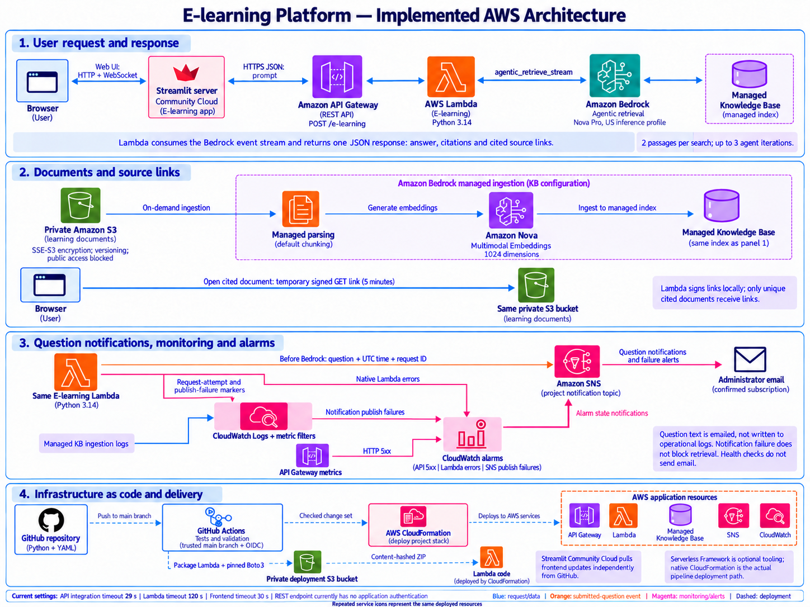

# Application architecture

This diagram and guide describe the implemented application, checked against the Python code, authored YAML, and deployed `e-learning-platform-dev` CloudFormation stack in `us-east-1`.

## Question and answer flow

1. **Browser to Streamlit.** The learner types a question or selects a suggestion, then clicks **Find answer**. Streamlit Community Cloud hosts the Python frontend. Browser interaction uses Streamlit's web connection; the browser does not call the question API directly.
2. **Streamlit to API Gateway.** The Streamlit server reads `API_URL` from its environment or hosting secrets and sends an HTTPS POST to `/dev/e-learning` with `{"prompt":"..."}`. The question limit is 2,000 characters. Selecting a suggestion alone does not submit a request.
3. **API Gateway to Lambda.** The regional REST API uses a custom Lambda integration. Its `application/json` request template passes the prompt to the existing `E-learning` function. API request validation rejects missing or non-text prompts; Lambda also trims and validates input. Other content types are not passed through.
4. **Notification before retrieval.** For a valid request, Lambda writes a request-attempt marker and publishes the question, UTC timestamp, request ID, and knowledge-base ID to SNS. SNS sends the notification through the confirmed administrator email subscription. A publishing failure is recorded, and retrieval continues. This email reports a submitted attempt, not a completed answer.
5. **Agentic retrieval and generation.** Lambda calls `bedrock-agent-runtime.agentic_retrieve_stream` with `generateResponse=True`. Nova Pro uses the configured US inference profile to plan retrieval and generate an answer from the managed knowledge base. The configuration requests two passages per search, allows up to three agent iterations, and disables reranking. The profile permits model execution in its US destination regions.
6. **Return the final answer.** Lambda consumes the Bedrock event stream and waits for its final result. It returns `answer`, `citations`, `results`, and `sources`. API Gateway unwraps the Lambda response body and preserves its HTTP status; Streamlit displays the answer. The application does not stream partial model text to the browser.
7. **Open a source.** Citation result indexes select the supporting documents. Lambda deduplicates their S3 identifiers and locally signs GET URLs only for the configured bucket and prefix. The default link lifetime is 300 seconds. When the learner clicks **Open source**, their browser reads the original document directly from private S3 using that temporary URL. The source list is not the entire sample library or every retrieved passage.

## Document preparation and storage

The source bucket contains the five demo text documents under `demo/learning/`. It uses SSE-S3 encryption, blocked public access, bucket-owner-enforced ownership, versioning, and a retain policy.

An on-demand data-source sync reads that prefix. Bedrock's managed ingestion uses `SMART_PARSING`, default chunking, and the selected Amazon Nova Multimodal Embeddings model (`amazon.nova-2-multimodal-embeddings-v1:0`). Embeddings use 1,024 FLOAT32 dimensions. Bedrock manages the search index and vector storage; the application does not provision an OpenSearch collection.

All five documents were indexed when reviewed. Uploading or changing an S3 file does not automatically start a new sync: no recurring sync schedule is configured. Source documents and deployment ZIPs use separate S3 buckets.

## Monitoring, notification, and failure paths

The same deployed Lambda and API appear again in the diagram's monitoring detail panel; those icons do not represent additional functions or APIs.

| Signal | Source and destination | Meaning |
| --- | --- | --- |
| Submitted question | Lambda publishes directly to the project SNS topic, then email | A valid question was submitted for a Bedrock attempt. |
| Request count | Lambda log marker to a CloudWatch metric filter | `BedrockRequestAttempts` counts application attempts, not internal model calls. |
| Publish failure | Lambda log marker to a metric filter and alarm | `QuestionNotificationFailures` records failures to publish to SNS. |
| Lambda failure | Native `AWS/Lambda` Errors metric to an alarm | Unhandled runtime failures and timeouts. Handled JSON error responses do not increment this metric. |
| API failure | Native `AWS/ApiGateway` 5XXError metric to an alarm | Server errors, including the handler's mapped HTTP 5xx responses. |
| Ingestion diagnostics | Bedrock application log delivery to a separate CloudWatch log group | Document crawl, parsing, and indexing activity. These logs are separate from the Lambda metric filters. |

The three alarms route through the same SNS topic. Each evaluates a one-minute window, triggers at one failure, and treats missing data as healthy. Alarm emails occur on entering ALARM; submitted-question emails use direct SNS publishes so they are not limited to alarm state transitions.

Lambda operational logs omit the question, answer, and document text. The notification email deliberately contains the question. Both Lambda and knowledge-base log groups retain logs for 30 days. Health checks and invalid empty questions do not publish notifications. SNS Standard can deliver duplicate messages; the request ID identifies the originating request.

## Deployment and access

GitHub Actions runs Python/frontend tests, dependency checks, YAML validation, CloudFormation lint, and deployment guard checks. Pull requests receive checks. Trusted `main` deployments use GitHub OIDC and the project-scoped deployment role.

The runner packages `lambda.py` and the pinned backend SDK into a content-hashed ZIP and uploads it to the private deployment bucket. It composes the native YAML fragments, validates the result, reviews a CloudFormation change set, and executes it. The main stack owns the API, Lambda, document storage, knowledge base, SNS, metric filters, alarms, and their project IAM/logging resources. The deployment-role bootstrap is a separate approved prerequisite stack.

The pipeline rejects destructive resource changes. API definition changes generate a new immutable API deployment snapshot while preserving the stage URL; old snapshots are retained. Post-deployment checks verify readiness, request mappings, monitoring resources, and email subscription status. The health/API validation checks do not invoke the model or send question emails.

Streamlit Community Cloud pulls frontend code changes independently from GitHub and has its own API connection settings. It is not provisioned by this CloudFormation stack. Serverless Framework remains optional checked-in tooling; the actual pipeline submits native CloudFormation YAML through the deployment script.

## Current design limits

| Area | Implemented behavior |
| --- | --- |
| Public endpoint | The REST method uses `AuthorizationType: NONE`. No application sign-in, API key requirement, or per-user authorization is implemented. Internal AWS calls use scoped service roles. |
| Response time | API integration: 29 seconds. Lambda: 120 seconds. Frontend default: 30 seconds. The gateway can time out before Lambda finishes. |
| Source access | A signed URL grants its holder temporary read access to that cited S3 object; it is not a per-user authorization mechanism. |
| Notifications | Publish is attempted before retrieval, with short SDK timeouts. There is no durable notification outbox. SNS publish acceptance and successful answer generation are separate events. |
| Retrieval scope | The two-result setting controls passages. Citation references and document deduplication determine the displayed source files. |
| Data freshness | Source changes require an explicit on-demand sync before they can affect indexed answers. |

## Code and template references

- [Frontend request and response handling](../streamlit-ui/api_client.py), [UI submission](../streamlit-ui/streamlit_app.py), and [frontend settings](../streamlit-ui/app_config.py).
- [Lambda retrieval, notifications, and source-link generation](../backend/src/lambda.py).
- [REST integration and mapping templates](../infrastructure/resources/api-gateway.yml) and [Lambda runtime/IAM configuration](../infrastructure/resources/lambda.yml).
- [Source bucket](../infrastructure/resources/knowledge-base-storage.yml), [managed knowledge base and connector](../infrastructure/resources/knowledge-base.yml), and [ingestion log delivery](../infrastructure/resources/knowledge-base-logging.yml).
- [SNS, metric filters, and alarms](../infrastructure/resources/monitoring.yml).
- [GitHub Actions](../.github/workflows/ci.yml), [native CloudFormation deployment](../infrastructure/scripts/deploy.py), and [bootstrap role](../infrastructure/bootstrap/github-deployment-role.yml).

Protocol references: [Streamlit client-server architecture](https://docs.streamlit.io/develop/concepts/architecture/architecture) and [Bedrock agentic retrieval and citation format](https://docs.aws.amazon.com/bedrock/latest/userguide/kb-test-agentic-retrieve.html).
